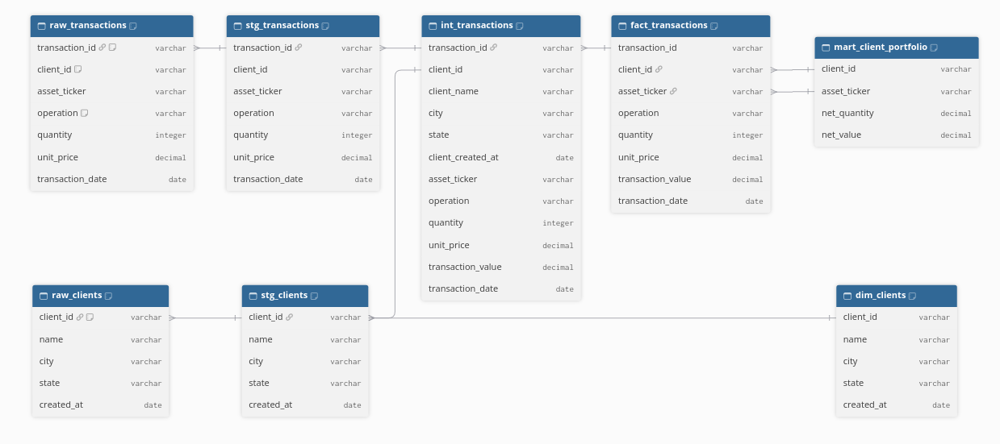
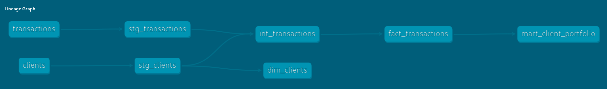
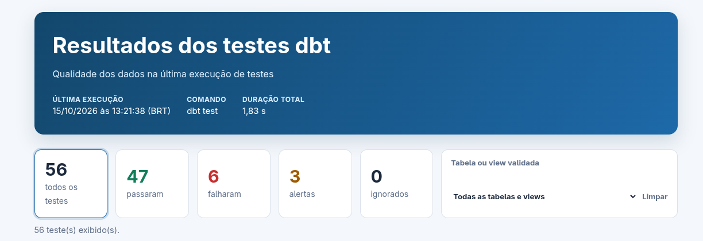
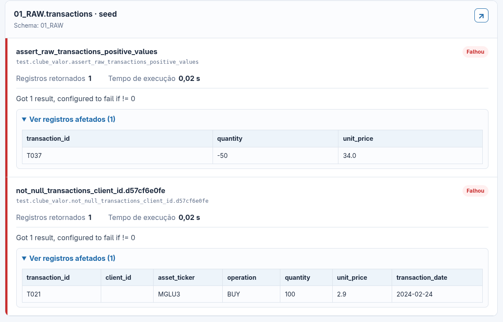
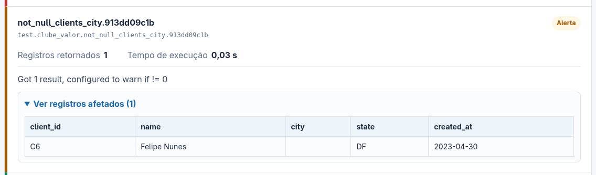

# Clube do Valor — Pipeline dbt

Projeto dbt para carregar transações e clientes em DuckDB, aplicar as transformações e validar a qualidade dos dados.

# Sobre mim


https://www.linkedin.com/in/renatocastellani/

# Como executar o projeto

## Pré-requisito

- Docker, para garantir o mesmo ambiente em qualquer máquina.

## Estrutura

```text
.
├── Dockerfile
├── dbt_project.yml
├── .dbt/profiles.yml        # conexão local com DuckDB
├── data/                    # banco DuckDB e relatórios gerados localmente
├── seeds/                   # CSVs de entrada versionados
├── models/
│   ├── _groups.yml          # agrupamento lógico dos modelos
│   ├── schema.yml           # documentação, testes e contratos
│   ├── staging/             # padronização, tipos e filtros
│   ├── intermediate/        # regras intermediárias
│   └── marts/               # fato, dimensão e portfólio
├── macros/                  # lógica SQL reutilizável
├── scripts/                 # extras de profiling e relatório de testes
└── tests/                   # testes singulares
```

No DuckDB, os objetos ficam organizados por schemas de camada:

| Camada | Conteúdo |
| --- | --- |
| `01_RAW` | Arquivos de origem carregados: `clients` e `transactions`. |
| `02_STG` | Views de dados preparados: `stg_clients` e `stg_transactions`. |
| `03_INT` | View de transações enriquecidas: `int_transactions`. |
| `04_MART` | Tabelas de consumo: `dim_clients`, `fact_transactions` e `mart_client_portfolio`. |

## Executar com Docker

Na raiz do projeto, construa a imagem:

```bash
docker build -t clube-valor-dbt .
```

Entre no contêiner montando a pasta local `data/`:

```bash
docker run --rm -it \
  --name clube-valor-dbt \
  --publish 8080:8080 \
  --mount type=bind,src="$PWD/data",dst=/app/data \
  clube-valor-dbt bash
```

Dentro do container, execute:

```bash
dbt seed
dbt run
dbt test
```

O banco DuckDB é salvo localmente em `data/clube_valor.duckdb`. Após executar `dbt seed` e `dbt run`, no DuckDB poderão ser visualizados os quatro schemas.

O `dbt test` valida a qualidade dos dados e identifica inconsistências de chaves, valores financeiros, operações e posições de carteira.

## Extras de observabilidade — não exigidos no case

- **Relatório HTML de testes:** torna alertas, falhas e registros afetados fáceis de consultar sem ler o log do terminal.
- **Relatório HTML de build:** evidencia recursos executados, bloqueados ou ignorados no gate integrado.
- **Profiling YData:** oferece uma visão exploratória da distribuição e qualidade de cada tabela ou view.

Após executar os comandos obrigatórios, gere o profiling e o relatório HTML de testes:

```bash
python scripts/generate_profiles.py
python scripts/generate_test_results_report.py
```

O relatório de testes deve ser gerado logo após `dbt test`, porque cada comando dbt substitui o `.dbt/target/run_results.json`. O profiling precisa vir depois de `dbt run` ou `dbt build`, quando as relações já existem; execute-o antes do relatório HTML para habilitar os links de profiling.

Para visualizar uma execução com o gate do dbt, use o build e gere o relatório correspondente:

```bash
dbt build
python scripts/generate_build_results_report.py
```

O resultado fica em `data/metadata/results_build/last_build_results.html`. Ele usa o `run_results.json` do build para mostrar seeds, modelos, testes, alertas, falhas e recursos downstream bloqueados.

Nesse fluxo, `dbt build` já executa os seeds, modelos e testes. Gere o relatório imediatamente depois dele; outro comando dbt substituiria o `run_results.json` usado pelo relatório.

O profiling YData fica em `data/metadata/results_profiling/`. O relatório fica em `data/metadata/results_tests/last_test_results.html`, agrupa os testes por tabela ou view e permite abrir o profiling correspondente. Os registros de alertas e falhas são armazenados no schema técnico `dbt_test__audit`.

Para gerar todos os artefatos de documentação e observabilidade em uma única sequência, execute:

```bash
bash scripts/generate_all_docs.sh
```

O script preserva os dois resultados separadamente: executa `dbt seed`, `dbt run` e `dbt test`, gerando o relatório de testes logo em seguida; depois executa `dbt build` e gera o relatório de build. O profiling é criado após o `dbt run`, quando as relações existem. Falhas de qualidade não interrompem a geração dos relatórios, mas fazem o script terminar com código diferente de zero.

Ao terminar os comandos dentro do contêiner, retorne ao terminal do host com:

```bash
exit
```

# Desenvolvimento e decisões tomadas

A primeira etapa da atividade foi entender os dados, modelagens, como se relacionavam, suas lógicas e inferir as regras de negócio usadas para criar as transformações.

Criei um digrama lógico das relações para trazer clareza no que precisa ser feito e do que foi construido.

## Diagrama lógico das relações

O diagrama abaixo resume o fluxo das tabelas e views: os seeds de origem passam pelo staging, a camada intermediate enriquece as transações, e os modelos MART disponibilizam a fato, a dimensão de clientes e a posição consolidada da carteira.

As linhas representam relações lógicas por identificadores, usadas para facilitar a leitura do modelo. Elas não representam chaves estrangeiras físicas no DuckDB.



## Pipeline dbt e arquitetura medalhão

O pipeline organiza a transformação dos dados em camadas, da origem ao consumo analítico:



1. **RAW — origem:** `clients` e `transactions` são carregados sem correções manuais, preservando os dados como recebidos.
2. **STG — preparação:** `stg_clients` e `stg_transactions` renomeiam e tipam os campos, além de remover registros sem chaves ou valores necessários para as transformações.
3. **INT — enriquecimento:** `int_transactions` relaciona cada transação a um cadastro de cliente e calcula o valor financeiro da operação.
4. **MART — consumo:** `dim_clients` disponibiliza a dimensão de clientes; `fact_transactions` materializa a fato incremental; e `mart_client_portfolio` consolida a posição por cliente e ativo.

`fact_transactions` usa `transaction_date` como controle incremental: novas execuções carregam somente datas posteriores à maior data já existente. Essa decisão é adequada ao escopo do case, mas não reprocessa eventos atrasados nem corrige registros históricos.

`mart_client_portfolio` calcula a posição líquida como **BUY menos SELL**, em quantidade e valor. A macro `signed_operation_value` centraliza a aplicação do sinal negativo nas vendas.

A qualidade é verificada com testes declarados em `models/schema.yml` (`not_null`, `unique` e `accepted_values`) e com o teste singular `assert_no_negative_position.sql`, que identifica posições líquidas negativas.

## Documentação do schema e testes

O `models/schema.yml` define a documentação dos modelos e colunas, além dos testes que especificam as condições mínimas para considerar cada dado como confiável.

As chaves de negócio recebem `not_null` para garantir que cada registro possa ser identificado e relacionado, e `unique` para impedir que o mesmo identificador represente mais de um registro. 
Isso se aplica, por exemplo, ao `client_id` dos clientes e ao `transaction_id` das transações: uma chave ausente ou duplicada pode associar uma operação ao cliente errado, contar o mesmo evento mais de uma vez ou impedir sua rastreabilidade. 
Campos com domínio fechado, como `operation`, recebem `accepted_values` para permitir somente os valores previstos — neste caso, `BUY` ou `SELL`.

Os testes estão organizados em dois pontos:

- **`models/schema.yml` — testes gerais:** `not_null` verifica a presença de chaves e campos necessários; `unique` protege a unicidade de `client_id` e `transaction_id`; e `accepted_values` garante que `operation` contenha somente `BUY` ou `SELL`. Eles são declarados junto aos seeds e modelos para acompanhar os dados desde a origem até o consumo.
- **`tests/assert_raw_transactions_positive_values.sql` — teste singular:** verifica na origem se quantidade e preço são positivos, evitando que valores financeiros inválidos avancem para os cálculos.
- **`tests/assert_no_negative_position.sql` — teste singular:** verifica o resultado final do portfólio e identifica posições líquidas negativas, que precisam ser avaliadas antes da publicação da carteira.

A severidade acompanha o impacto: inconsistências de chaves e valores financeiros bloqueiam a confiança do modelo, enquanto problemas cadastrais não financeiros podem ser acompanhados como alertas.

Os testes são aplicados nas camadas em que cada desvio pode ser identificado, preservando a rastreabilidade entre origem, transformação e consumo.

## Resultados da execução e próximos passos

O pipeline foi executado com sucesso: `dbt seed` carregou 27 clientes e 100 transações, e `dbt run` materializou os seis modelos. O staging reteve 98 transações válidas; duas foram descartadas: uma sem `client_id` e a transação `T037`, com quantidade negativa.



Foram executados 56 testes: 47 passaram, 3 geraram alertas e 6 falharam. O retorno de erro no `dbt test` é intencional: indica que o modelo ainda não deve ser certificado para consumo irrestrito.

### As falhas críticas estão concentradas em quatro situações:

- a transação `T037`, com quantidade negativa, rejeitada no staging;
- uma transação sem `client_id`;
- identificadores de cliente duplicados, detectados na origem, no staging e na dimensão;
- seis posições com mais vendas que compras.

### Exemplos das falhas no visualizador de resultados de testes:




Esses casos podem distorcer valores financeiros, fazer a mesma operação aparecer mais de uma vez ou romper o vínculo entre uma transação e seu investidor. Quando o mesmo `client_id` aparece em dois cadastros, uma transação poderia se juntar aos dois e virar duas linhas; o modelo intermediário escolhe um único cadastro para evitar essa duplicação técnica. Isso não corrige os cadastros nem decide qual registro é válido — essa decisão cabe à área de negócio.

Os três alertas representam o mesmo problema cadastral: uma cidade ausente, preservada e acompanhada em RAW, STG e MART. Ela prejudica análises geográficas, mas não altera o cálculo financeiro.


## Próximos passos

A proposta do case é forçar a execução e envio de dados materializados para camada de consumo e rodar os testes de validação e qualidade dos dados.

Mas em ambiente produtivo ao invés de rodar apenas o 

```bash
dbt seed
```
eu rodaria o 

```bash
dbt build
```
que tem o mesmo efeito do seed, mas com a vantagem de não fazer as validações de qualidade em busca de falhas críticas antes de enviar para materialização e consumo de ambiente produtivo.
Então não precisaria do seed, somente o build e se houverem falhas graves como aconteceu no nosso caso, não rodaria o 'dbt run' antes de resolvê-los.

O próximo passo é investigar a causa-raiz das inconsistências com as áreas de negócio e de TI. Além de corrigir os dados atuais, é necessário definir uma melhoria que evite a repetição do problema.

### Investigações necessárias antes de enviar para produção
As perguntas abaixo precisam ser respondidas antes de certificar os modelos para consumo em produção:

1. **Clientes — identificadores duplicados**
   - Por que existem registros com o mesmo `client_id`?
   - A tabela é imutável e mantém o histórico de alterações cadastrais? Se sim, existe uma coluna de data ou versão para identificar o registro mais recente?
   - Ou houve um erro na geração ou no controle dos identificadores?

2. **Transações — quantidade negativa**
   - A quantidade negativa representa uma correção, cancelamento ou estorno?
   - Essa regra deve ser aceita no modelo ou o registro precisa ser corrigido na origem?

3. **Transações — cliente não informado**
   - Por que há transações sem `client_id`?
   - A operação realmente ocorreu e pode ser associada posteriormente a um cliente?

4. **Carteira — posição líquida negativa**
   - Por que existem posições negativas no `mart_client_portfolio`?
   - Há transações históricas ausentes que expliquem a diferença entre compras e vendas?
   - A área de negócio permite posição vendida ou espera somente saldos não negativos?
